  

 
 
 

  

  

<a href="https://github.com/uhmpasterig/useful-react-types"><b>useful-react-types</b></a> &nbsp;collection of React types that make your life easier 
<a href="https://github.com/uhmpasterig/l0cked"><b>l0cked</b></a> &nbsp;base of a script and application marketplace, Next.js + Turborepo 
<a href="https://github.com/uhmpasterig/nestjs-turbo-microservices"><b>nestjs-turbo-microservices</b></a> · <a href="https://github.com/uhmpasterig/config-microservice-example"><b>config-microservice-example</b></a> &nbsp;NestJS microservice playgrounds 
<a href="https://github.com/uhmpasterig/altv-server"><b>altv-server</b></a> &nbsp;one of my first big C# projects, DI and EF Core

  

