### Hi, I'm uhmpasterig

Building software for public transit. Formerly reverse-engineering games.

Full-stack since 2019 · TypeScript, C#, Rust, Lua · Next.js, NestJS, ASP.NET Core · PostgreSQL, Redis · Docker

### Projects

| Project | What it does | Built with |
| :-- | :-- | :-- |
| [**mergegraph**](https://github.com/uhmpasterig/mergegraph) | The graph above: GitHub and a self-hosted GitLab in one | TypeScript |
| [**fivem-network-logger**](https://github.com/uhmpasterig/fivem-network-logger) | Logs every event of every resource on a FiveM server | C++ |
| [**unluac-54**](https://github.com/uhmpasterig/unluac-54) | Lua 5.4 bytecode decompiler | Java |
| [**react-orbit-component**](https://github.com/uhmpasterig/react-orbit-component) | Puts any element on an animated orbit | TypeScript, npm |
| [**nest-redis-config**](https://github.com/uhmpasterig/nest-redis-config) | Shared NestJS config over Redis | TypeScript, npm |
